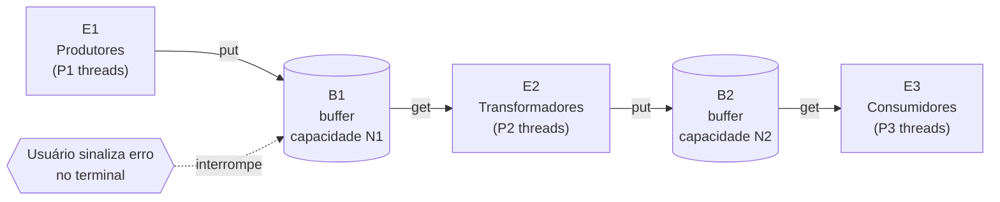

# Pipeline Concorrente de Três Estágios com Interrupção Externa

**Disciplina:** Programação Concorrente
**Linguagem / API:** C com Pthreads

---

## 1. Introdução

A programação concorrente permite que várias linhas de execução (threads) cooperem sobre dados compartilhados, o que traz ganhos de desempenho, mas também exige cuidado com condições de corrida, bloqueios e encerramento correto das threads. Um dos padrões clássicos desse domínio é o **produtor-consumidor**, em que threads produtoras e consumidoras trocam dados por meio de um buffer de capacidade limitada.

Em sistemas reais, esse padrão raramente aparece isolado: é comum encadear vários estágios de processamento, formando uma **pipeline**, em que a saída de um estágio é a entrada do seguinte. Além disso, esses sistemas precisam lidar com **eventos externos**, como falhas ou interrupções, sem corromper a memória compartilhada e sem deixar threads presas.

Este trabalho propõe um problema de concorrência baseado em uma pipeline de três estágios, com múltiplas threads por estágio e dois buffers de tamanhos distintos. Durante a execução, o usuário pode sinalizar um erro pelo terminal, que representa uma falha temporária em um dos buffers da pipeline, com duração de 5 segundos. Enquanto a falha dura, parte da pipeline fica parada e o restante continua operando. Passado esse tempo, o buffer volta a funcionar e a pipeline retoma a execução normal. O programa deve reagir a essa interrupção e à posterior recuperação de forma ordenada, tratando corretamente as threads e a memória compartilhada.

O objetivo do trabalho é formalizar esse problema, definindo seus elementos, restrições e o comportamento esperado do sistema, e, em seguida, resolvê-lo utilizando threads POSIX (Pthreads) e os mecanismos de sincronização estudados na disciplina.

---

## 2. Formalização do problema proposto

### 2.1 Visão geral

O sistema é uma pipeline composta por três estágios (**E1**, **E2** e **E3**) conectados por dois buffers de capacidade limitada (**B1** e **B2**). Cada estágio é executado por um conjunto de threads.


### 2.2 Parâmetros

| Símbolo | Significado | Restrição |
|---------|-------------|-----------|
| `P1` | número de threads do estágio E1 | `P1 ≥ 1` |
| `P2` | número de threads do estágio E2 | `P2 ≥ 1` |
| `P3` | número de threads do estágio E3 | `P3 ≥ 1` |
| `N1` | capacidade do buffer B1 (em itens) | `N1 ≥ 1` |
| `N2` | capacidade do buffer B2 (em itens) | `N2 ≥ 1` e `N2 ≠ N1` |
| `M` | número total de itens que E1 deve produzir na execução | `M ≥ 1` |
| `T` | duração da falha em B1 após a interrupção | `T = 5 s` |

Os buffers possuem **tamanhos diferentes** (`N1 ≠ N2`), o que faz com que cada um fique cheio ou vazio em momentos distintos e gere cenários de bloqueio diferentes em cada ponto da pipeline.

### 2.3 Itens

Um **item** é a unidade de dado que percorre a pipeline. Cada item possui, no mínimo:

- um identificador único;
- um conteúdo (*payload*), que é modificado pelo estágio E2.

### 2.4 Estágios

**E1: produção.** As `P1` threads geram itens novos e os depositam em B1. Se B1 estiver cheio, a thread produtora deve aguardar até que haja espaço.

**E2: transformação.** As `P2` threads retiram itens de B1, aplicam uma transformação ao item e o depositam em B2. Uma thread de E2 é, ao mesmo tempo, consumidora de B1 e produtora de B2. Se B1 estiver vazio, a thread aguarda um item. Se B2 estiver cheio, a thread aguarda espaço.

**E3: consumo final.** As `P3` threads retiram itens de B2 e os consomem, registrando o resultado. Esse estágio marca o fim da pipeline. Se B2 estiver vazio, a thread aguarda um item.

### 2.5 Buffers

Cada buffer é uma estrutura de capacidade finita, compartilhada entre as threads dos estágios adjacentes, com política de atendimento **FIFO**:

```
 B1  (capacidade N1 = 6, exemplo)
 +----+----+----+----+----+----+
 | I4 | I5 | I6 |  . |  . |  . |      3 itens presentes, 3 vagas livres
 +----+----+----+----+----+----+
   ^ próximo a sair (E2)      ^ próxima posição a escrever (E1)


 B2  (capacidade N2 = 4, exemplo)
 +----+----+----+----+
 | I1 | I2 |  . |  . |                 2 itens presentes, 2 vagas livres
 +----+----+----+----+
   ^ próximo a sair (E3)  ^ próxima posição a escrever (E2)
```

Legenda: `I<n>` = item de identificador *n*; `.` = posição livre.

Requisitos sobre os buffers:

- B1 é compartilhado por `P1` produtoras e `P2` consumidoras; B2 é compartilhado por `P2` produtoras e `P3` consumidoras.
- Nunca pode haver mais de `N1` itens em B1 nem mais de `N2` itens em B2.
- Um item não pode ser retirado de um buffer vazio nem depositado em um buffer cheio.
- Cada item depositado deve ser retirado **no máximo uma vez** (sem duplicação) e por apenas uma thread.

### 2.6 A interrupção externa

Durante a execução, o usuário pode **sinalizar um erro pelo terminal**. Essa entrada representa uma falha **temporária** no buffer **B1**, que é a saída do estágio E1 e a entrada do estágio E2, e torna necessário parar a parte inicial da pipeline durante `T = 5` segundos. Passado esse tempo, a falha cessa e B1 volta a funcionar.

Características da interrupção:

- Ocorre de forma **assíncrona** em relação às threads dos estágios: pode acontecer a qualquer momento da execução, inclusive com os buffers em qualquer estado (vazios, parcialmente cheios ou cheios) e com threads bloqueadas ou em processamento.
- Cada interrupção dura exatamente `T` segundos. Um novo comando de erro digitado enquanto uma falha já está ativa é ignorado.
- A recuperação de B1 ocorre sozinha, sem nenhuma ação do usuário.
- Não é gerada pelas threads da pipeline, e sim pelo usuário.

### 2.7 Comportamento esperado

**Durante a falha (os `T = 5` segundos após a interrupção):**

1. **O conteúdo de B1 é perdido.** Todos os itens que estavam armazenados em B1 no momento da interrupção são descartados e não prosseguem na pipeline. Esses itens são contabilizados como perdidos.
2. **As threads de E1 param.** Nenhum item é depositado em B1 enquanto a falha durar. Threads de E1 que estiverem aguardando vaga em B1 permanecem em espera, sem consumir processamento.
3. **As threads de E2 param.** Nenhum item é retirado de B1 enquanto a falha durar. Threads de E2 que estiverem aguardando item em B1 permanecem em espera. Uma thread de E2 que já tenha retirado um item de B1 **antes** da interrupção conclui o processamento desse item e o deposita em B2 normalmente.
4. **As threads de E3 continuam funcionando.** O estágio final não é afetado pela falha em B1 e segue consumindo itens de B2 normalmente. Se B2 ficar vazio antes do fim da falha, as threads de E3 aguardam por novos itens e **não encerram**.

**Ao fim da falha (após 5 segundos):**

5. **B1 volta a operar vazio.** O buffer retoma o funcionamento normal, sem os itens perdidos.
6. **E1 e E2 retomam a execução.** As threads de E1 voltam a produzir e depositar itens em B1, e as threads de E2 voltam a retirar itens de B1, transformá-los e depositá-los em B2, como antes da interrupção. Um item que uma thread de E1 já tenha gerado, mas ainda não depositado em B1 quando a falha ocorreu, **não** é perdido: ele é depositado após a recuperação.
7. **A pipeline segue até o fim.** O programa continua até que E1 tenha produzido os `M` itens e todos os itens produzidos que não foram perdidos tenham percorrido a pipeline até E3.

**Término do programa:**

8. **O programa termina de forma limpa.** Todas as threads são finalizadas (nenhuma fica bloqueada indefinidamente) e o programa exibe um relatório final.

Quando **não** há interrupção, a execução ocorre exatamente como descrito acima, sem os itens 1 a 5, e termina após E1 produzir os `M` itens e todos eles percorrerem a pipeline até E3.

### 2.8 Linha do tempo esperada

```
tempo ---------------------------------------------------------------------------->

E1 (P1 threads) : produzindo ==========|..... parado .....|========== produzindo ====> fim
B1              : operando   ==========|  falha: perdido  |== operando (volta vazio) ==>
E2 (P2 threads) : processando =========|. conclui item em mãos, depois parado .|=== processando ===> fim
B2              : recebendo  ==========|  só é esvaziado   |=== recebendo de novo ===>
E3 (P3 threads) : consumindo ==========|=== consumindo (se B2 esvaziar, aguarda) ===|=== consumindo ===> fim
                                       ^                   ^
                                usuário sinaliza      passam 5 s:
                                erro no terminal      B1 se recupera
                                |<------- T = 5 s ------->|
```

### 2.9 Propriedades que devem valer

- **Segurança dos dados:** não há perda, duplicação ou corrupção de itens fora do que a interrupção determina (apenas o conteúdo de B1 no momento da interrupção é perdido).
- **Continuidade de E3:** as threads de E3 não encerram nem ficam inativas de forma permanente por causa da falha; apenas aguardam quando B2 está vazio.
- **Retomada:** após `T` segundos, E1 e E2 voltam a operar sem intervenção do usuário.
- **Limites dos buffers:** a ocupação de B1 e B2 nunca excede `N1` e `N2`, respectivamente.
- **Conservação de itens:** ao final da execução, o total de itens produzidos é igual ao total de itens consumidos por E3 somado ao total de itens perdidos em B1.
- **Ausência de deadlock:** nenhuma thread permanece bloqueada ao final da execução.
- **Terminação:** o programa sempre termina, com ou sem interrupção, após todos os itens não perdidos chegarem a E3.
- **Sem espera ocupada:** threads que aguardam por item ou por vaga não consomem processamento enquanto esperam.

### 2.10 Entradas e saídas

**Entradas:**
- parâmetros `P1`, `P2`, `P3`, `N1`, `N2` e `M`;
- comando de erro digitado pelo usuário no terminal durante a execução (opcional).

**Saídas:**
- mensagens de acompanhamento da execução (produção, transformação e consumo de itens);
- mensagem de interrupção recebida e mensagem de recuperação de B1 após os 5 segundos;
- relatório final contendo: itens produzidos, itens consumidos por E3 e itens perdidos em B1.

Exemplo de relatório final:

```
===== RELATÓRIO FINAL =====
Itens produzidos (E1) ........ 44
Itens consumidos (E3) ........ 40
Itens perdidos (B1) .......... 4
Conservação: 44 = 40 + 4  [OK]
```

---

## 3. Algoritmo de resolução

<!-- A ser preenchido -->

---

## 4. Conclusão

<!-- A ser preenchido -->

---

## 5. Referências

<!-- A ser preenchido -->
